  

  
  

## GitHub activity

  

## About ME

I'm a Computer Engineering student at **Shahid Beheshti University**, driven by curiosity and a genuine interest in understanding how things work.

I enjoy building software, exploring different areas of engineering, and getting into the details that make systems work from backend architecture and communication protocols to automation and application development. I've worked with technologies like **.NET, Java, Flutter, Go, and Python**, and I enjoy moving between them as different problems call for different approaches.

I'm not particularly interested in sticking to one stack or following a predefined path. I would rather explore unfamiliar concepts, build things from scratch, and understand the reasoning behind the solutions I use.

Beyond code, music has always been a big part of my life. I play the **piano and violin**, and I'm rarely far from a pair of headphones. I'm also a long-time gamer, with **Dota 2** being a particular favorite.

I like figuring things out, asking questions, and taking on problems that make me think. That's probably what keeps me interested in engineering in the first place.## Technical toolkit

<table align="center">
  <thead>
    <tr>
      <th>Area</th>
      <th>Technologies</th>
    </tr>
  </thead>
  <tbody>
    <tr>
      <td><strong>Languages</strong></td>
      <td><code>C#</code> <code>Java</code> <code>Python</code> <code>Dart</code> <code>C</code> <code>C++</code> <code>SQL</code></td>
    </tr>
    <tr>
      <td><strong>Backend</strong></td>
      <td><code>.NET</code> <code>ASP.NET Core</code> <code>GraphQL</code> <code>Entity Framework Core</code> <code>ASP.NET Identity</code> <code>JWT</code></td>
    </tr>
    <tr>
      <td><strong>Application &amp; systems</strong></td>
      <td><code>Flutter</code> <code>TCP sockets</code> <code>Multithreading</code></td>
    </tr>
    <tr>
      <td><strong>Data &amp; tooling</strong></td>
      <td><code>SQLite</code> <code>MySQL</code> <code>Git</code> <code>Linux</code> <code>JSON persistence</code></td>
    </tr>
  </tbody>
</table>

  

## Selected work

- **[Clean Book Auth API](https://github.com/Parsa-Attaran/Clean-Book-Auth-API)** — Layered GraphQL API with identity management, JWT authentication, and SQLite persistence. 
  `C#` · `.NET 10` · `GraphQL` · `Entity Framework Core`

- **[Music Player](https://github.com/Parsa-Attaran/Music-Player)** — Collaborative client–server music application using TCP sockets and framed JSON messaging. 
  `Flutter` · `Dart` · `Java` · `TCP`

- **[Sudoku BP](https://github.com/Parsa-Attaran/Sudoku-BP)** — Terminal Sudoku game with generated levels, persistent progress, hints, undo, timing, and leaderboards. 
  `C++` · `Persistence` · `Algorithms`

- **[Learn Linux](https://github.com/Parsa-Attaran/Learn-Linux)** — Practical Persian guide covering Linux files, permissions, processes, streams, `grep`, regular expressions, and globbing. 
  `Linux` · `Technical writing`

[View all repositories →](https://github.com/Parsa-Attaran?tab=repositories)

## Currently exploring

- Authentication architecture and token lifecycle design
- Stateful automation for operational and administrative workflows
- DevOps fundamentals and reliable delivery pipelines
- Data structures, algorithms, and maintainable system boundaries

## Connect

If you would like to discuss backend systems, automation, or a project idea:

- **Email:** [parsa.attaran84@gmail.com](mailto:parsa.attaran84@gmail.com)
- **Telegram:** [@In_depthSci](https://t.me/In_depthSci)
